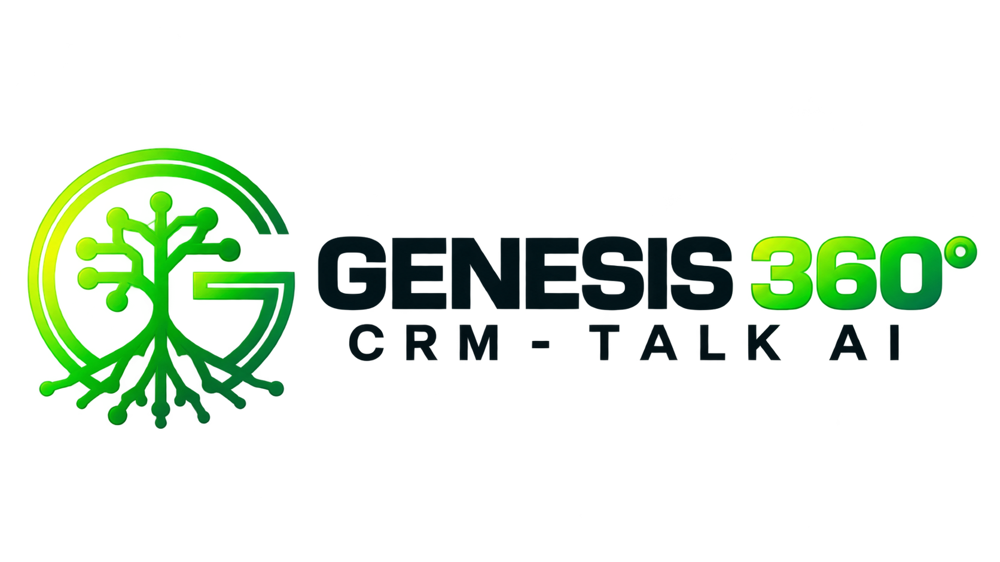

<div align="center">



# Genesis 360 Talk AI

**Atendimento, vendas e inteligência artificial em uma única plataforma.**

Centralize conversas de WhatsApp, organize seu CRM e conecte sua equipe a agentes
de IA, com instalação no seu próprio servidor.

[O que faz](#o-que-o-genesis-faz) · [Funcionalidades](#funcionalidades-do-sistema) · [Instalar](#instalação-na-vps) · [Primeiro acesso](#primeiro-acesso)

</div>

## O que o Genesis faz

O **Genesis 360 Talk AI** reúne atendimento humano, agentes de IA e gestão comercial
para acompanhar o cliente da primeira conversa ao fechamento.

- **WhatsApp integrado:** atendimento por QR code via WAHA ou canal oficial da
  Meta, com conversas, anexos e transferência entre atendentes.
- **CRM e funis:** contatos, oportunidades e etapas de venda organizados em Kanban.
- **Agentes de IA:** atendimento e qualificação com base de conhecimento, ferramentas
  do CRM e passagem para uma pessoa quando necessário.
- **Follow-ups e automações:** acompanhamento de contatos, regras por eventos,
  webhooks e retomada de oportunidades.
- **Supervisão 360:** visão conjunta da operação humana e de IA, com filas, carga
  da equipe, falhas, tempos de resposta, filtros e custos registrados.
- **Agenda e tarefas:** organização dos compromissos e das próximas ações da equipe.
- **Uso no celular:** interfaces adaptadas para trabalhar com Inbox, contatos, CRM,
  agenda e tarefas em telas menores.
- **Organizações e permissões:** separação dos dados entre empresas, controle de
  acesso por função e recursos de auditoria e privacidade.

## Funcionalidades do sistema

Os recursos abaixo fazem parte do código desta versão. A disponibilidade para
cada usuário depende das permissões, dos módulos habilitados e das integrações
configuradas. Recursos com provedores externos precisam de credenciais e
homologação no ambiente de instalação.

### Atendimento e WhatsApp

- **Inbox:** conversas com atendimento humano e IA, histórico, mensagens e anexos,
  atualizações em tempo real e atribuição de responsáveis.
- **Fila e transferências:** passagem da IA para a equipe, distribuição de
  conversas e retomada do atendimento humano.
- **Respostas rápidas:** textos reutilizáveis pessoais ou compartilhados com a equipe.
- **Radar:** acompanhamento de conversas abertas e contatos sem resposta ou atividade.
- **Conexões:** gestão de números, pareamento por QR code via WAHA, estado das
  sessões e configuração do canal oficial da Meta e seus templates.
- **Preferências de atendimento:** visibilidade das conversas, distribuição,
  disponibilidade dos atendentes e limites de carga.

### CRM, contatos e vendas

- **Funis e Kanban:** acompanhamento dos negócios por etapa, responsáveis,
  ganhos e perdas; configuração de etapas, vocabulário e motivos de perda.
- **Contatos e ficha do negócio:** cadastro, telefones, histórico de relacionamento,
  atividades, tags e informações ligadas às conversas e oportunidades.
- **Produtos:** catálogo com preços para consulta da equipe e dos agentes de IA.
- **Campanhas:** seleção de contatos e envio de mensagens respeitando o ritmo
  configurado para o número.
- **Prospecção:** busca de empresas e preparação de abordagens graduais com IA.
- **CRM B2B, opcional:** empresas, CNPJ, decisores, pessoas com múltiplos telefones
  e importação de lotes CSV/XLSX, com acompanhamento da importação.
- **Propostas comerciais, opcionais:** elaboração, revisão, envio e aceite;
  modelos personalizáveis, validade e condições comerciais. Exigem habilitação
  na instalação e na organização.

### Agenda e tarefas

- **Agenda:** compromissos individuais e da equipe, responsáveis e visualização
  dos agendamentos, incluindo compromissos em andamento.
- **Tipos de agendamento:** definição de duração, local e pessoas que atendem.
- **Disponibilidade:** configuração de fuso e janelas de atendimento da equipe.
- **Tarefas:** acompanhamento de prazos, pendências, atrasos e conclusão,
  com ações adaptadas ao celular.
- **Planos de tarefa:** sequências reutilizáveis de atividades para aplicar aos negócios.

### Agentes e inteligência artificial

- **Agentes:** configuração de instruções, modelos, ferramentas e publicação.
- **Roteadores:** escolha do agente que recebe cada conversa e regras para
  transferência ao atendimento humano.
- **Conhecimento e RAG:** fontes e materiais do negócio usados como referência
  para as respostas dos agentes.
- **Memória:** informações da operação que o agente pode reutilizar.
- **Skills e ferramentas:** ações que a IA pode executar no CRM durante o atendimento.
- **Fluxos de atendimento, opcionais:** roteiros de perguntas conduzidos pela IA,
  com respostas vinculadas à ficha do cliente.
- **Provedores e credenciais:** escolha da inteligência usada em cada parte do
  sistema e gestão das chaves dos provedores suportados.
- **Casos e alertas:** acompanhamento dos atendimentos conduzidos pela IA,
  desfechos e situações que precisam de decisão humana.
- **Avisos no WhatsApp:** configuração de destinatário para avisos de casos,
  dependente de canal conectado e entrega real validada.
- **Propostas de melhoria da IA:** sugestões para revisão e aprovação humana.
- **Execuções:** histórico das ações da IA e informações sobre falhas.
- **Uso e orçamento:** consumo, tokens, custos registrados e limites de gasto.
- **Evolução da IA:** indicadores para acompanhar resultados e necessidades de aprendizado.

### Follow-ups e automações

- **Follow-ups:** fluxos para retomar contatos, acompanhar oportunidades e
  executar etapas conforme condições e eventos do atendimento.
- **Editor visual:** organização de etapas e conexões, histórico para desfazer
  alterações e opção de desconectar elementos sem apagá-los.
- **Inscrições e execução:** acompanhamento dos contatos em cada fluxo e de
  seus estados de processamento.
- **Consentimento:** tratamento de STOP/opt-out e pausas nas jornadas de follow-up.
- **Automações por eventos:** regras de condições e ações, como aplicar tags,
  mover negócios, atribuir responsáveis, enviar mensagens e chamar webhooks.
- **Atividade das integrações:** histórico das execuções, resultados e tratamento
  de falhas, conforme a integração.

### Supervisão 360 e análise

- **Supervisão humana e IA:** visão operacional com 15 populações/indicadores,
  incluindo filas, espera, atuação humana e automática, follow-ups vencidos,
  falhas, passagens de atendimento e chamadas de IA.
- **Equipe:** presença, disponibilidade, carga e recortes por responsável.
- **Resultados:** negócios ganhos/perdidos, primeira resposta humana,
  passagens pendentes e sinais de indisponibilidade dos canais.
- **Filtros e detalhamento:** período, atendente, agente, canal e funil,
  com paginação e acesso aos registros de origem.
- **Custos:** tokens e valores conhecidos da telemetria, com indicação separada
  de chamadas sem preço registrado.
- **Desempenho:** acompanhamento do funil e da performance por atendente.
- **Meta Ads:** conexão da conta de anúncios e análise dos resultados disponíveis.
- **Auditoria:** registro das ações e consulta ao histórico operacional.

### Integrações e extensões

- **Nuvemshop:** conexão da loja para integrar clientes e pedidos ao CRM.
- **Webhooks de entrada:** recebimento de leads de formulários e sistemas externos.
- **Webhooks de saída:** comunicação de eventos e resultados para outras ferramentas.
- **API e MCP:** acesso autorizado ao CRM por integrações e ferramentas de agentes,
  com tokens e controles de permissão.
- **Integração de dados externos, opcional:** configuração de fontes externas,
  sujeita à habilitação pelo administrador da instalação.
- **Extensões e módulos:** catálogo e administração de recursos adicionais;
  cada extensão depende de instalação, compatibilidade e configuração próprias.

### Financeiro e serviços

- **Comandas:** registro dos serviços realizados, profissionais envolvidos e valores.
- **Faturamento:** acompanhamento de entradas, formas de pagamento e valores
  associados aos profissionais.
- **Configuração financeira:** contas, formas de pagamento e classificação dos lançamentos.
- **Honorários, opcional:** modelos de cobrança por caso e calendário de parcelas,
  mediante instalação e ativação do módulo.
- **Billing e cobrança:** telas de plano e cobrança da organização; a operação
  depende da configuração e, quando aplicável, dos provedores de pagamento.

### Voz e telefonia opcionais

- **Chamadas:** histórico de ligações por IA e transcrições disponíveis.
- **Trunk SIP:** configuração das credenciais do provedor de telefonia.
- **Serviços de voz:** ativação pelos profiles documentados para telefonia e voz,
  com credenciais, infraestrutura e provedores correspondentes.

### Organização, segurança e privacidade

- **Equipe e papéis:** convites, usuários e permissões por função.
- **Organizações:** dados da empresa, configurações e isolamento entre empresas.
- **Marca própria:** nome, cores e identidade configuráveis por instalação/organização.
- **Perfil e notificações:** idioma, fuso, avatar e preferências de aviso.
- **Autenticação:** login, recuperação de acesso, MFA opcional, códigos de
  recuperação e gestão de sessões.
- **LGPD:** solicitações de exportação e exclusão/anonimização, retenção e
  informações do encarregado, respeitando os fluxos e permissões do sistema.
- **API Tokens:** gestão do acesso autorizado de sistemas externos.
- **Recursos opcionais:** controles de habilitação disponíveis conforme o papel
  e o nível de administração.

### Administração da plataforma

- **Empresas e usuários:** administração das organizações e contas da instalação.
- **Administradores:** controle das pessoas com acesso administrativo à plataforma.
- **Configuração central:** políticas de cadastro, marca, e-mail, integrações,
  módulos e parâmetros da instalação.
- **Acompanhamento:** painéis administrativos, uso, saúde por organização,
  incidentes e auditoria.
- **Suporte:** acesso às ferramentas administrativas de atendimento conforme
  as permissões e as regras de auditoria.

### Operação no próprio servidor

- **Implantação:** instalação e atualização manual pelos wrappers Genesis.
- **Health:** verificação autenticada de banco/API e Auth.
- **Backup:** bundles com banco, componentes locais necessários, hashes,
  contagens e contrato de permissões/schema/RLS.
- **Restore e rollback:** validações de integridade e compatibilidade antes de
  recuperar dados ou retornar às imagens anteriores.
- **Monitoramento:** verificação dos serviços e da idade/integridade dos backups,
  com incidentes deduplicados e avisos de recuperação.
- **Cópia externa e alertas:** configuração de destino de backup e receptor de
  alertas, com ativação do cron no servidor.

A interface conta com navegação para celular, busca de telas e temas claro/escuro.
A atualização automática Genesis permanece adiada. A liberação para produção
continua condicionada à homologação na VPS, integrações reais e ensaios de
recuperação descritos no [guia Contabo](deploy/contabo/README.md).

## Instalação na VPS

A instalação do Genesis utiliza o kit próprio em `deploy/contabo`, que prepara e
compila os serviços no servidor. Há duas opções: Supabase na mesma VPS ou um
projeto Supabase externo.

> **Versão 1.77 — candidato de homologação.** O código foi validado em CI;
> a homologação na Contabo e com provedores reais permanece pendente.
> O [guia de instalação](deploy/contabo/README.md) detalha os requisitos e a operação.

### O que você precisa

| Item        | Requisito                                                                            |
| ----------- | ------------------------------------------------------------------------------------ |
| Servidor    | VPS Linux AMD64 ou ARM64, com acesso SSH e permissão para operar o Docker            |
| Memória     | Piso de 4 GB; 8 GB recomendados. A compilação pode exigir swap                       |
| Disco       | Pelo menos 20 GiB livres para passar no preflight; dimensione também dados e backups |
| Ferramentas | Docker com Compose, Git e utilitários listados no guia de instalação                 |
| Domínio     | Registro DNS A apontando para a VPS e portas 80/443 disponíveis para o Caddy         |
| Supabase    | Na mesma VPS ou um projeto externo dedicado, com schema `public` vazio               |
| WhatsApp    | Número para pareamento via QR code ou credenciais do canal oficial da Meta           |
| IA          | Credenciais do provedor escolhido, configuráveis posteriormente na plataforma        |
| E-mail      | SMTP configurado no Supabase Auth para confirmação e recuperação de senha            |

Se a VPS já tiver um proxy nas portas 80/443, siga a integração descrita no guia
antes de instalar.

### 1. Conecte-se ao servidor

No terminal do computador, use os dados SSH fornecidos pela hospedagem:

```bash
ssh -p PORTA USUARIO@IP_DA_VPS
```

Substitua `PORTA`, `USUARIO` e `IP_DA_VPS`. A porta SSH padrão é `22`.
Os próximos comandos são executados dentro da VPS.

### 2. Baixe o candidato validado

```bash
git clone --branch genesis-v1.77.0-rc.1 --depth 1 https://github.com/hudsonlcustodio/GENESISTALKV177.git genesis-360-talk-ai
cd genesis-360-talk-ai
```

Escolha **uma** das opções abaixo para uma instalação nova.

### 3A. Instale com Supabase na mesma VPS

Nesta opção, o kit prepara o Supabase local, gera as credenciais e instala os
serviços Genesis. Execute em um clone novo, sem `.env` ou instalação anterior.

```bash
bash deploy/contabo/install.sh --single-server --domain crm.seudominio.com.br
```

Troque `crm.seudominio.com.br` pelo domínio que já aponta para a VPS.
A instalação gera as credenciais iniciais em `.runtime/admin-credentials`,
com acesso protegido no servidor.

### 3B. Instale com Supabase externo

Use um projeto Supabase dedicado, sem tabelas existentes no schema `public`.
No Supabase Auth, configure:

- **Site URL:** `https://crm.seudominio.com.br`
- **Redirect URL:** `https://crm.seudominio.com.br/auth/confirm`

Prepare o arquivo de configuração:

```bash
cp deploy/contabo/.env.example .env
chmod 600 .env
```

Edite o `.env` no servidor e preencha os campos obrigatórios do
[template de instalação](deploy/contabo/.env.example), incluindo:

| Configuração           | O que informar                                                                                              |
| ---------------------- | ----------------------------------------------------------------------------------------------------------- |
| Domínio e URLs         | `DOMAIN`, `ACME_EMAIL`, `NEXT_PUBLIC_APP_URL` e `NEXT_PUBLIC_ADMIN_URL`                                     |
| Supabase público       | `NEXT_PUBLIC_SUPABASE_URL` e `NEXT_PUBLIC_SUPABASE_ANON_KEY`                                                |
| Supabase servidor      | `SUPABASE_SERVICE_ROLE_KEY`, `SUPABASE_DB_URL` e `SUPABASE_DB_ADMIN_URL` do mesmo projeto                   |
| Segurança e serviços   | Segredos de aplicação, cifra, cron, WAHA e Redis indicados no template; preserve os pares e hashes exigidos |
| Primeiro administrador | `OWNER_EMAIL`, `OWNER_PASSWORD` e `OWNER_ORG_NAME`                                                          |

As chaves do Supabase seguem o contrato do instalador: chave pública
anon/publishable e chave de servidor service-role/secret. IA e SMTP podem ser
configurados posteriormente; o SMTP do Auth é necessário para os e-mails de acesso.

Depois de preencher a configuração:

```bash
bash deploy/contabo/install.sh --external
```

O instalador aplica o banco inicial, cria o primeiro administrador, compila e
inicia os serviços Genesis. Depois do bootstrap, remova `OWNER_PASSWORD` do `.env`.
Mantenha o arquivo protegido e fora do Git.

## Primeiro acesso

1. Abra `https://crm.seudominio.com.br`, usando o domínio configurado.
2. Entre com o administrador criado na instalação. No modo single-server,
   consulte as credenciais iniciais no arquivo protegido `.runtime/admin-credentials`.
3. Configure a organização e a equipe.
4. Conecte o WhatsApp por QR code ou configure o canal oficial da Meta.
5. Cadastre as credenciais de IA, prepare a base de conhecimento e configure os agentes.
6. Organize os funis, tarefas e follow-ups da operação.

Para conferir a instalação pelo terminal:

```bash
bash deploy/contabo/smoke.sh
```

Os procedimentos de atualização manual, backup e recuperação estão no
[guia Contabo](deploy/contabo/README.md). Esta versão utiliza os wrappers Genesis;
seu canal de atualização automática ainda está adiado.

---

Baseado no [DeskcommCRM](https://github.com/melgarafael/DeskcommCRM), com
personalizações Genesis e preservação da [licença MIT](LICENSE).
